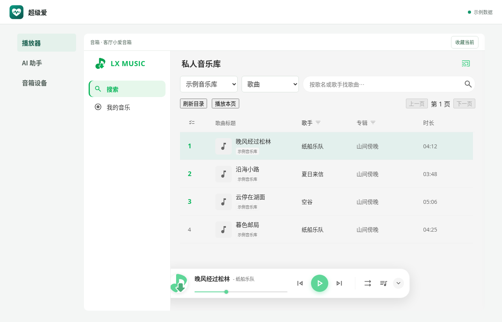
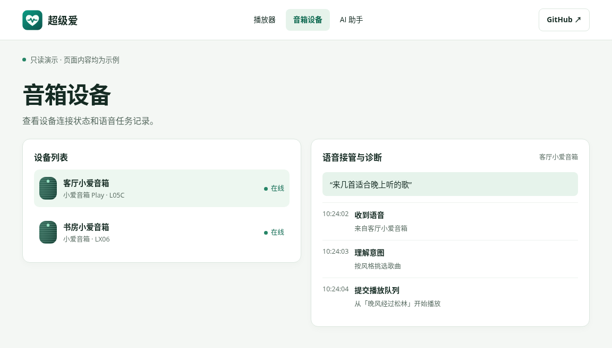
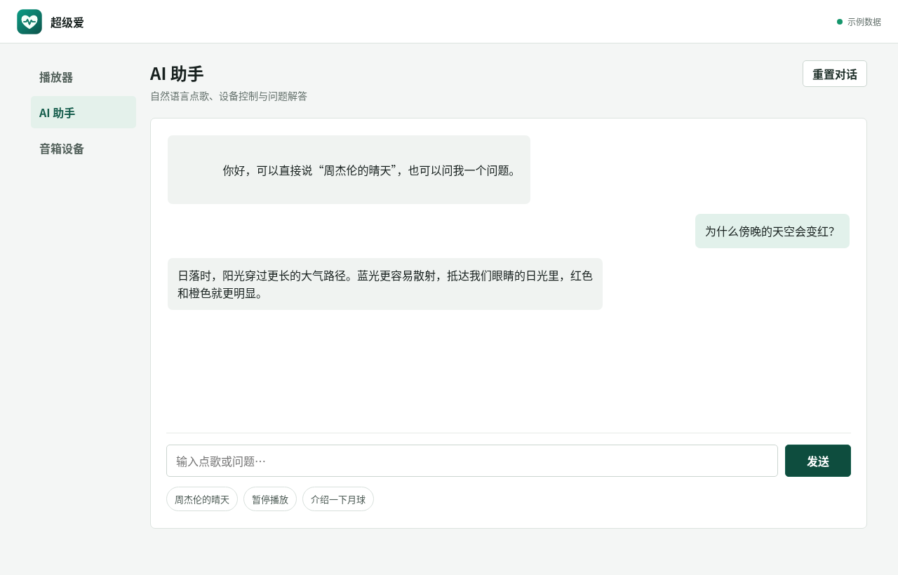

# 超级爱 (superai)

[简体中文](README.md) · [User guide](docs/index.en.md) · [Online guide](https://taoke-one.github.io/superai/guide/en/) · [Deployment configuration](docs/deployment.en.md) · [Apache-2.0](LICENSE) · [Live preview](https://taoke-one.github.io/superai/)

A self-hosted web player and voice assistant for Xiaomi speakers. Play music in your browser, cast it to a speaker, or ask XiaoAi to play music and answer questions. The platform runs on Docker or Node.js.

## Features

- **Web and speaker playback** with queues, lyrics, favorites, history, playlists, and four playback modes.
- **Music libraries** from Navidrome / Subsonic, fnOS Music, and WebDAV. You can also import your own LX source for songs, playlists, and charts.
- **XiaoAi integration** with Xiaomi QR sign-in, device discovery, per-speaker conversation monitoring, music requests, and playback controls. When enabled, the platform reads Xiaomi cloud conversation records and uses AI to interpret requests.
- **AI answers** using MiniMax or an OpenAI-compatible service. The originating speaker can read answers and clarification questions aloud and keep context for follow-up replies.

## Interface preview

These screenshots show the running SuperAI app with sample data. The read-only preview lets you switch between the player, speaker devices, and AI assistant. [Live preview](https://taoke-one.github.io/superai/)

[](https://taoke-one.github.io/superai/#player)

[](https://taoke-one.github.io/superai/#devices)

[](https://taoke-one.github.io/superai/#assistant)

## Deploy

Choose one deployment method. After setup, open [http://localhost:8787](http://localhost:8787) on the deployment host.

### Option 1 — Docker image

The Docker Hub image includes FFmpeg and supports Linux `amd64` and `arm64`. Docker selects the matching architecture automatically. ARM devices need a 64-bit operating system.

```bash
docker run -d --name superai --restart unless-stopped \
  -p 8787:8787 -v superai-data:/data \
  taokeone/superai:0.1.1
```

Settings, playlists, and the key live in the `superai-data` volume. Both registries provide versioned tags and `latest`. [Docker Hub](https://hub.docker.com/r/taokeone/superai) · [GitHub Container Registry](https://github.com/TaoKe-One/superai/pkgs/container/superai)

`-p 8787:8787` publishes the port on all host interfaces. For LAN access, open `http://<host-LAN-IP>:8787` from another device. For host-only access, use `-p 127.0.0.1:8787:8787`. To change the binding for an existing container, recreate it with its original data volume. [LAN access](docs/deployment.en.md#lan-access)

You can also pull from GitHub or use the same reference in the run command above.

```bash
docker pull ghcr.io/taoke-one/superai:0.1.1
```

### Option 2 — Docker Compose

Create `compose.yaml` in your deployment directory with the following contents.

```yaml
services:
  superai:
    image: taokeone/superai:0.1.1
    restart: unless-stopped
    ports:
      - "8787:8787"
    volumes:
      - speaker-data:/data

volumes:
  speaker-data:
```

Run this in the same directory.

```bash
docker compose up -d
```

You can also set `image` to `ghcr.io/taoke-one/superai:0.1.1`. For an existing Compose deployment, update the image in the same project to keep its data volume. [Repository Compose configuration](docs/deployment.en.md#docker-compose)

### Option 3 — Command line

Download **Source code** for your chosen version from GitHub Releases, or clone the repository. Run the commands below in the project root. Install Node.js 22.6+ (a supported Node.js LTS version is recommended) and npm. For WebDAV audio that requires transcoding, install FFmpeg and add it to `PATH`. [Stable releases](https://github.com/TaoKe-One/superai/releases)

```bash
cp .env.example .env
npm ci --omit=dev
npm start
```

Data goes into `data/` by default. Set `DATA_DIR` in `.env` to choose a persistent directory. After updating the source, reinstall dependencies and restart the process.

For LAN access, reverse proxies, or signed audio URL redirects, see the [deployment guide](docs/deployment.en.md).

GitHub-generated source archives include `test/` for development and CI. If you have a separately distributed `*-deploy.zip`, extract it and follow the same steps. Deployment ZIPs and Docker images exclude test files.

### One-click upgrades in Settings

Open **Settings → System Update** to check for stable GitHub releases. With `docker run`, first deploy an image that supports one-click upgrades and start the separate updater container. Then **Upgrade Now** downloads and switches the image while keeping the port mappings and data volume. The app restarts briefly, and you need to sign in again. If the new container fails its health check, the updater restores the previous container and configuration. [Setup steps](docs/deployment.en.md#one-click-upgrades-in-settings)

One-click upgrades are currently available in the development version. Update the public v0.1.1 release, Docker Compose deployments, and Node.js deployments manually using the corresponding steps. [Deployment and updates](docs/deployment.en.md)

## First run

1. Open the admin page and follow the prompts to create an administrator password.
2. Connect a private library under Music Services in settings, or import an LX source script you have permission to use in the player's Music Sources panel. The online catalog and playback sources are configured separately.
3. Go to Speaker Devices, scan the Xiaomi sign-in QR code, and select a speaker. Skip this step for browser playback. To cast a private library track, enter a platform LAN address the speaker can reach in Music Services.
4. For voice requests, test and save a model under AI Models in settings, then enable conversation monitoring in Speaker Devices. Try asking XiaoAi to play a song or explain how tides work.

In the development version, open the password panel in Settings and enter your current password and a new one of at least five characters. Sign in again on each device with the new password after saving. The public v0.1.1 release provides a password recovery command inside the container. [v0.1.1 release notes](https://github.com/TaoKe-One/superai/releases/tag/v0.1.1)

## Speaker compatibility

The platform selects the [music endpoint](src/miot/playback.ts) and [Mi Home speech action](src/miot/tts-commands.json) by hardware model. Music and Mi Home speech were heard on a Xiaomi XiaoAi Speaker Play (L05C, firmware 1.68.2). Verify casting, conversation retrieval, and audible speech separately on other models and firmware versions.

Voice monitoring is off by default. When enabled, XiaoAi may respond natively before the platform handles a request. XiaoAi handles appliances and infrared commands. Music comes from the libraries or sources you configure.

## Develop

```bash
npm ci
npm test
npm run dev
```

Server code is in `src/`, the web interface in `public/`, and tests in `test/`. See the [third-party notices](vendor/NOTICE.md) and [asset manifest](vendor/lx-lock.json) for the player source, hashes, and import steps.

When reporting a problem, include the deployment method, speaker model and firmware, reproduction steps, and redacted errors.

## License

Project code is distributed under [Apache-2.0](LICENSE). Bundled third-party components retain their licenses and attributions. [Third-party notices](vendor/NOTICE.md)

## Acknowledgments

Thank you to the projects and contributors whose work informed this platform.

- **Songloft MIoT plugin** for Xiaomi device discovery, playback control, and model-specific Mi Home speech. [songloft-org/songloft-plugin-miot](https://github.com/songloft-org/songloft-plugin-miot)
- **Songloft XiaoAi voice helper** for natural-language commands, AI questions, and spoken replies. [birdstudy-nj/songloft-miot-helper](https://github.com/birdstudy-nj/songloft-miot-helper)
- **LX Music Desktop** for the online catalog, playlist, chart, and lyrics modules. [lyswhut/lx-music-desktop](https://github.com/lyswhut/lx-music-desktop)
- **LX Music for Songloft** for the player assets adapted here. Thanks to fly818 and LX Team. [fly818/lxmusic-plugin-release 3.8.0](https://github.com/fly818/lxmusic-plugin-release/releases/tag/3.8.0)
