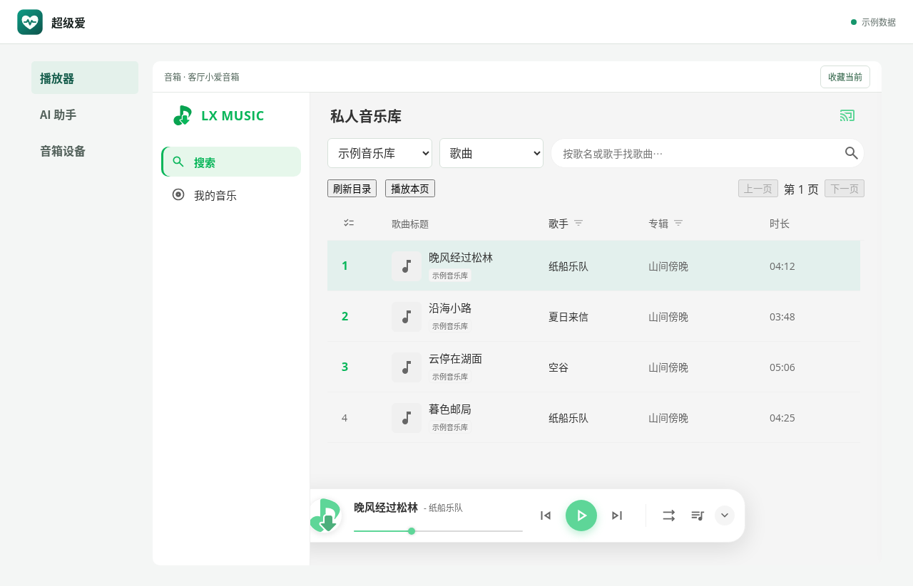
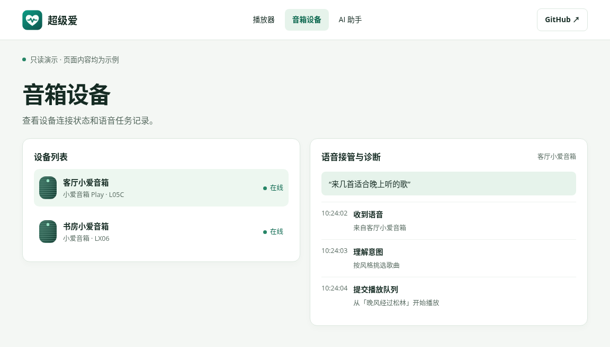
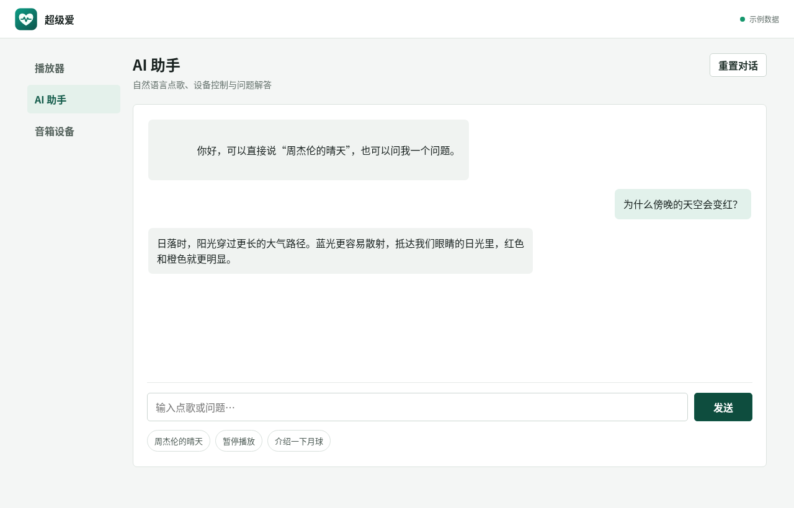

# 超级爱（superai）

[English](README.en.md) · [使用手册](docs/index.md) · [在线手册](https://taoke-one.github.io/superai/guide/) · [部署配置](docs/deployment.md) · [Apache-2.0](LICENSE) · [在线预览](https://taoke-one.github.io/superai/)

自托管网页播放器和小爱音箱助手。用浏览器播放音乐、投放到音箱，或直接对小爱说出点歌和问答请求。平台独立运行，部署时只需要 Docker 或 Node.js。

## 功能

- **播放器**支持网页版和音箱投放，提供播放队列、歌词、收藏、播放历史、歌单和四种播放模式。
- **音乐库**支持 Navidrome / Subsonic、飞牛音乐、WebDAV，也可导入自备的 LX 音源。在线目录支持歌曲、歌单和排行榜。
- **小爱联动**支持米家扫码、设备发现、多台音箱独立监听、点歌和播放控制。开启监听后，平台从小米云端读取对话，由 AI 理解意图并执行。
- **AI 问答**支持 MiniMax 和 OpenAI 兼容服务。回答和澄清可由提问的音箱播报，后续补充沿用该音箱的对话上下文。

## 界面预览

截图来自超级爱实际运行的界面，内容使用示例数据。在线预览可切换播放器、音箱设备和 AI 助手。 [在线预览](https://taoke-one.github.io/superai/)

[](https://taoke-one.github.io/superai/#player)

[](https://taoke-one.github.io/superai/#devices)

[](https://taoke-one.github.io/superai/#assistant)

## 部署

任选一种部署方式。部署完成后，可在部署机上打开 [http://localhost:8787](http://localhost:8787)。

### 方式一：Docker 镜像

GHCR 镜像内置 FFmpeg，包含 Linux `amd64` 和 `arm64` 两个版本。Docker 会根据系统架构自动选择。ARM 设备需要运行 64 位系统。

```bash
docker run -d --name superai --restart unless-stopped \
  -p 8787:8787 -v superai-data:/data \
  ghcr.io/taoke-one/superai:0.1.8
```

配置、歌单和密钥保存在 `superai-data` 数据卷。[Docker Hub](https://hub.docker.com/r/taokeone/superai) · [GitHub Container Registry](https://github.com/TaoKe-One/superai/pkgs/container/superai)。当前 v0.1.8 已确认发布到 GHCR。Docker Hub 仅作为同步完成后的可选地址，当前请使用上面的 GHCR 地址。

`-p 8787:8787` 将端口发布到宿主机的所有接口。局域网设备用 `http://<部署机局域网IP>:8787` 访问，只允许本机访问时用 `-p 127.0.0.1:8787:8787`。已有容器需要沿用原数据卷重新创建，才能更改端口绑定。[局域网访问](docs/deployment.md#局域网访问)

也可以直接拉取 GitHub 镜像，或将上面的镜像名替换为同一地址。

```bash
docker pull ghcr.io/taoke-one/superai:0.1.8
```

### 方式二：Docker Compose

在部署目录创建 `compose.yaml`，填入以下内容。

```yaml
services:
  superai:
    image: ghcr.io/taoke-one/superai:0.1.8
    restart: unless-stopped
    ports:
      - "8787:8787"
    volumes:
      - speaker-data:/data

volumes:
  speaker-data:
```

在同一目录执行。

```bash
docker compose up -d
```

也可以将 `image` 改为 `ghcr.io/taoke-one/superai:0.1.8`。已有 Compose 部署请在原项目中更新镜像，以继续使用原数据卷。[仓库内的 Compose 配置](docs/deployment.md#docker-compose)

标准部署只需要发布 `8787`。如果音箱收到音乐投放后停在 0 秒，再按[音箱地址转跳配置](docs/deployment.md#音箱收到投放后没有声音)显式启用 `8788`。转跳端口只绑定音箱可访问的局域网地址，不能使用 `127.0.0.1`，也不要做公网端口转发。

### 方式三：命令行

从 GitHub Releases 下载所需版本的 **Source code**，或克隆仓库，然后在项目根目录执行下面的命令。安装 Node.js 22.6+（建议使用受支持的 Node.js LTS 版本）、npm 和 `unzip`（用于后台升级）。使用需要转码的 WebDAV 音频时，还需要安装 FFmpeg 并将其加入 `PATH`。[正式版本](https://github.com/TaoKe-One/superai/releases)

```bash
cp .env.example .env
npm ci --omit=dev
npm start
```

默认写入项目下的 `data/`。首次部署或更换机器时，可在 `.env` 中通过 `DATA_DIR` 指定持久化目录。后台安装的版本保存在数据目录中，重启后会继续使用。

需要局域网访问、反向代理或签名音频地址转跳时，见[部署配置](docs/deployment.md)。

GitHub 自动生成的源码包包含供开发和 CI 使用的 `test/` 目录。若拿到单独分发的 `*-deploy.zip`，解压后也可按上面步骤部署。部署 ZIP 和 Docker 镜像均已排除测试文件。

### 后台一键升级

包含内置升级的版本通过 `docker run`、Docker Compose 或 `npm start` 正常启动后，升级服务会一起运行。登录后打开「**平台设置 → 系统更新**」，点击「检查更新」。发现新版后，点击「立即升级」。平台会验证正式部署包，保留原数据目录，短暂重启并验证新版。新版启动失败时会恢复原程序和数据。[更新与迁移说明](docs/deployment.md#后台一键升级)

## 第一次使用

1. 打开管理页面，按页面提示创建管理员密码。
2. 打开「平台设置 → 音乐服务」，接入已有私人曲库，或者在播放器的「音乐源管理」导入你有权使用的 LX 音源脚本。在线目录与可播放音源分别配置。
3. 到「音箱设备」扫描小米登录二维码，选择音箱。浏览器播放可跳过这一步。投放私人曲库时，在音乐服务中填写音箱能访问的平台局域网地址。
4. 如需语音助手，先到「平台设置 → AI 模型」测试并保存模型，再到「音箱设备 → 语音接管与诊断」开启监听。可以对音箱说「播放周杰伦的晴天」或「帮我解释一下潮汐是怎么形成的」。

自 v0.1.2 起，可在「平台设置 → 修改管理员密码」验证当前密码并设置至少 5 个字符的新密码。保存后需要在各设备上用新密码重新登录。容器内密码恢复命令自 v0.1.1 起提供。[v0.1.1 发布说明](https://github.com/TaoKe-One/superai/releases/tag/v0.1.1)

## 音箱兼容性

平台根据硬件型号选择[音乐投放接口](src/miot/playback.ts)和[米家播报动作](src/miot/tts-commands.json)。小爱音箱 Play（L05C，固件 1.68.2）已有音乐播放和米家播报的真机记录。其他型号可按实际固件分别验证投放、语音记录和播报。

语音联动默认关闭。开启后，音箱可能先执行小爱的原生响应。家电和红外指令仍由小爱处理。音乐来自你配置的音乐库或音源。

## 开发

```bash
npm ci
npm test
npm run dev
```

服务端代码在 `src/`，网页在 `public/`，测试在 `test/`。播放器资源的来源、哈希和重新导入方式见[第三方来源说明](vendor/NOTICE.md)及[资源清单](vendor/lx-lock.json)。

提交问题时请附上部署方式、音箱型号和固件版本、复现步骤及脱敏后的错误信息。

## 许可证

项目代码采用 [Apache-2.0](LICENSE)。随项目分发的第三方组件保留各自的许可和归属说明。[第三方来源说明](vendor/NOTICE.md)

## 致谢

感谢这些项目及其贡献者提供的实现和经验：

- **Songloft MIoT 插件**提供小爱设备发现、播放控制和多型号米家播报的参考。[songloft-org/songloft-plugin-miot](https://github.com/songloft-org/songloft-plugin-miot)
- **Songloft 小爱语音助手**提供自然语言指令、AI 问答和音箱语音回复的参考。[birdstudy-nj/songloft-miot-helper](https://github.com/birdstudy-nj/songloft-miot-helper)
- **洛雪音乐桌面版**提供在线目录、歌单、排行榜和歌词模块。[lyswhut/lx-music-desktop](https://github.com/lyswhut/lx-music-desktop)
- **洛雪音源 Songloft 插件**提供本项目所适配的播放器前端资源。感谢 fly818 与 LX Team。[fly818/lxmusic-plugin-release 3.8.0](https://github.com/fly818/lxmusic-plugin-release/releases/tag/3.8.0)
