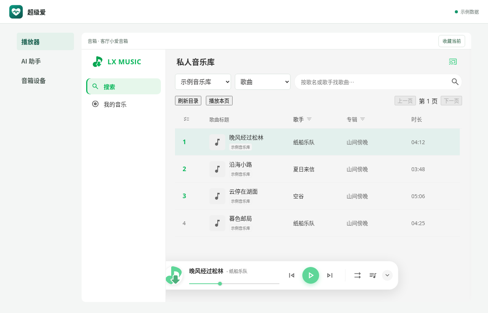
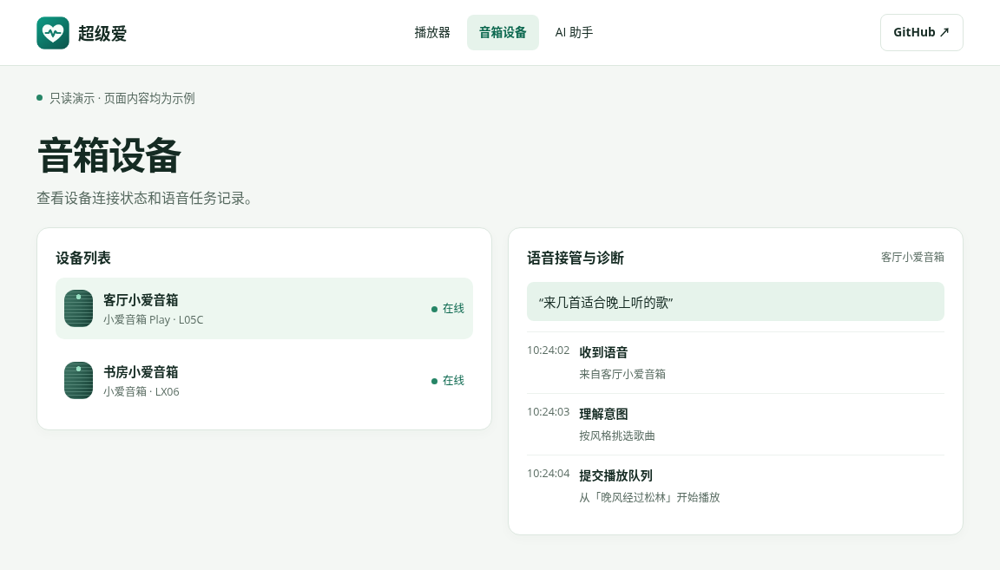
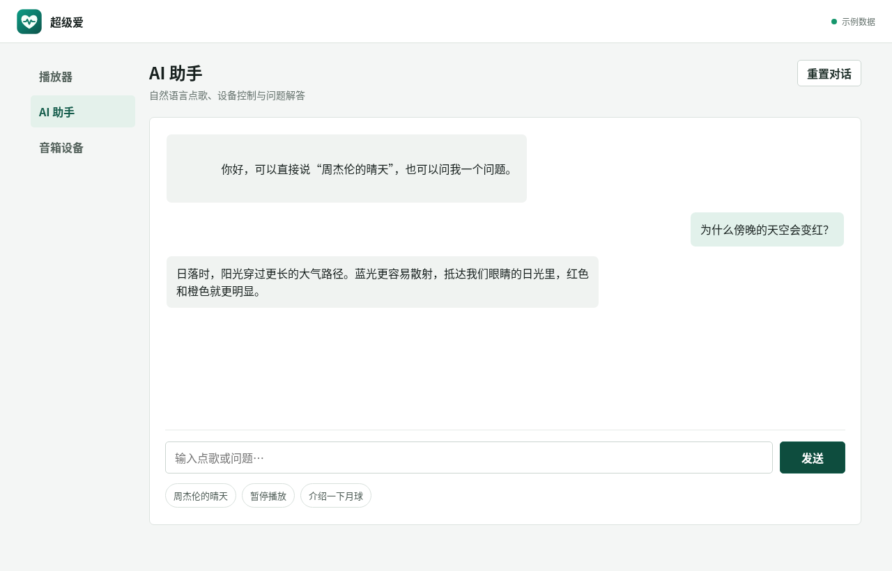

# Feature guide

[简体中文](usage.md) · [User guide](index.en.md)

## Connect music libraries and sources

Choose a source mode in **Settings → Music Services** and save. The mode applies to browser playback, voice requests, playlists, and replaying favorites.

| Source mode                          | When to use it                                                                            |
| ------------------------------------ | ----------------------------------------------------------------------------------------- |
| LX online only                       | Browse online search, charts, and playlists, and use enabled LX sources for playback URLs |
| Private libraries only               | Play connected private libraries with LX search and resolution turned off                 |
| Private libraries first, LX fallback | Search private libraries first and supplement results through LX                          |
| LX and advanced compatibility APIs   | Keep existing HTTP JSON or topone source integrations                                     |

### Add a private library

1. Open **Settings → Music Services** and choose **Add Private Library**.
2. Select the service type and enter an address reachable from the deployment host. Supply the required credentials or access code. Navidrome uses its Subsonic-compatible API. For fnOS Music, enter the full direct URL.
3. Save. Subsonic, Navidrome, and fnOS read the catalog directly. WebDAV scans the files after saving and exposes folders as browsable playlists.
4. To cast from a private library, fill in the platform URL the speaker can reach, such as `http://192.168.1.20:8787`. For Docker, use the host LAN address and published port.

Search your private library by song or artist in the player. The screenshots use sample data. Select any screenshot to open it at full size.

### Import an LX source

Open **Player → Music Sources**, import a compatible LX script you have permission to use, enable it, and run the availability check. Search, charts, and playlists provide catalog entries. Playback sources resolve the stream URLs. The check validates sample tracks. If a QQ Music track fails, confirm the source is enabled and supports QQ Music, then test the requested track.

## Playback and casting

- Double-click a track row in search, charts, a private library, recent plays, or a playlist to start the current list at that track. The player mode controls what plays next.
- Open **Player → My Music** for favorites, recent plays, and saved playlists. Select tracks in search or charts and import them to a playlist.
- Under **Speaker Devices**, scan the Xiaomi sign-in QR code, refresh devices, and select a speaker. Try casting a track that already plays in the browser.
- Disconnect the speaker in the player to continue playback in the browser. Reconnecting attempts to cast the current track. After a successful new voice request, the browser follows the target speaker's queue.

## AI models and voice integration

1. Open **Settings → AI Models**, choose MiniMax or another compatible provider, and enter the API base URL, model name, and key. Use the versioned base URL, such as one ending in `/v1`.
2. Test the model, then save. Model discovery depends on the provider. You can enter the model name manually.
3. Ask a question in **AI Assistant** to verify a text reply. Configure provider search or external search under **Settings → Web Search** for questions that need current information.
4. Enable monitoring under **Speaker Devices → Voice Diagnostics**. Use command preview to inspect how a request is interpreted. Then ask the speaker to play a few songs by an artist or answer a question.

SuperAI reads Xiaomi cloud conversation records, identifies intent, and handles music requests, playback controls, and questions. Supported speakers read answers aloud. Clarifications can continue on the same speaker. XiaoAi handles appliances, infrared controls, scenes, and reminders. Its native reply may play before SuperAI responds.

## Passwords and updates

In the development version, **Settings → Change Administrator Password** verifies the current password and accepts a new password of at least five characters. Changing the password signs out all administrator sessions. Deployments configured for one-click updates can check and install stable releases under **Settings → System Update**. See the deployment guide for public v0.1.1 recovery and updates. [Password recovery](deployment.en.md#forgotten-administrator-password) · [One-click upgrades](deployment.en.md#one-click-upgrades-in-settings)
