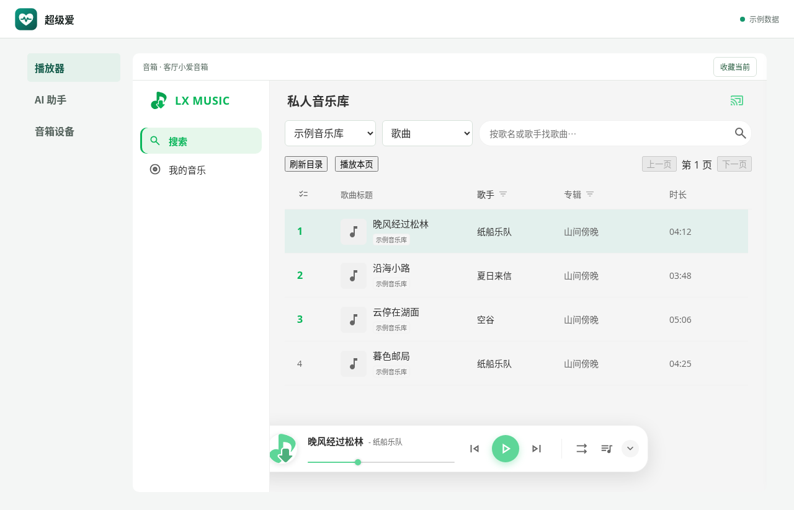
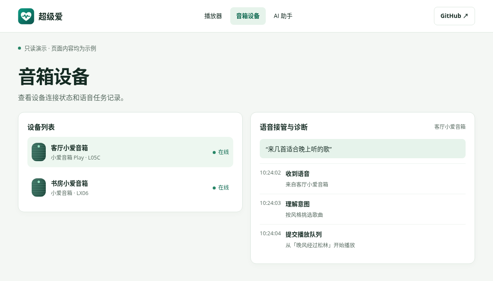
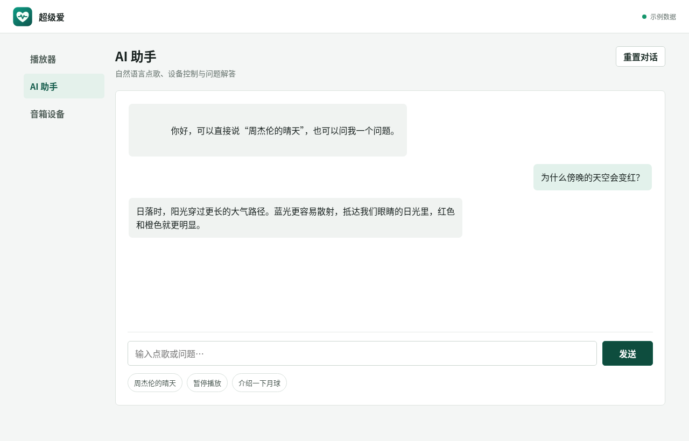

# 功能使用

[English](usage.en.md) · [使用手册](index.md)

## 连接音乐库和音源

在「平台设置 → 音乐服务」选择来源模式，保存后应用到播放器、语音点歌、歌单和收藏重播。

| 来源模式                | 适合的场景                                               |
| ----------------------- | -------------------------------------------------------- |
| 仅 LX 在线音乐          | 使用在线搜索、排行和歌单，并通过启用的 LX 源解析播放地址 |
| 仅私人音乐库            | 播放已连接的私人库，关闭 LX 检索与解析                   |
| 私人音乐库优先，LX 补充 | 从私人库优先查找，按来源规则补充 LX 结果                 |
| LX + 高级兼容接口       | 继续使用现有的 HTTP JSON 或 topone 接口配置              |

### 添加私人库

1. 在「平台设置 → 音乐服务」点击「添加私人音乐库」。
2. 选择服务类型，填入部署机能够访问的地址及对应账号或访问码。Navidrome 使用 Subsonic 兼容接口。飞牛音乐填写完整直连地址。
3. 保存设置。Subsonic、Navidrome 和飞牛直接读取目录。WebDAV 保存后扫描文件，文件夹也可作为歌单浏览。
4. 如果要投放私人库，在同一设置页填写「音箱可访问的平台地址」，如 `http://192.168.1.20:8787`。容器部署使用宿主机的局域网地址和映射端口。

播放器中的私人曲库可按歌曲或歌手检索。下方截图使用示例数据，点击可查看大图。

### 导入 LX 音源

打开「播放器 → 音乐源管理」，导入你有权使用的兼容 LX 脚本，启用后点击「检测可用性」。搜索、排行和歌单提供曲目目录，音源负责解析播放地址。检测只验证所选样本，播放时还要看来源是否支持该曲目。QQ 歌曲无法播放时，先查看该音源是否启用并支持 QQ，再用目标歌曲重试。

## 播放与投放

- 在搜索、排行榜、私人库、最近播放或歌单中双击歌曲行，从该曲开始播放当前列表。播放器的顺序、循环和随机设置决定后续如何切歌。
- 在「播放器 → 我的音乐」查找收藏、最近播放及已保存歌单。搜索或排行榜可选中多首歌曲，再导入到歌单。
- 在「音箱设备」扫码登录小米账号，刷新设备并选择目标音箱。先用一首能在网页播放的歌测试投放。
- 播放器断开音箱后，可在当前网页继续播放。重新连接会尝试把当前曲目投到音箱。新的语音点歌成功投放后，网页会跟随对应的音箱队列。

## AI 模型与语音联动

1. 在「平台设置 → AI 模型」选择 MiniMax 或其他兼容厂商，填写 API 基础地址、模型名称和密钥。地址填写到 API 版本路径，如 `/v1`。
2. 点击「测试模型」，通过后保存设置。可用模型列表随厂商变化，支持手动填写模型名称。
3. 在「AI 助手」先发一个问题验证文字回答。需要实时资料时，在「平台设置 → 联网检索」配置厂商内置搜索或外部搜索。
4. 在「音箱设备 → 语音接管与诊断」开启监听。可先用「指令预览」看系统如何理解请求，再对音箱说「播放周杰伦的几首热门歌曲」或「月球离地球有多远」。

平台读取小米云端对话记录，分析意图后执行点歌、播放控制或问答。问答在支持的设备上由音箱播报，澄清可接续同一音箱的对话。家电、红外、场景和提醒由小爱处理。小爱的原生回答可能先于平台播放。

## 管理密码和升级

自 v0.1.2 起，「平台设置 → 修改管理员密码」要求验证当前密码，新密码至少 5 个字符。改密后所有管理员会话都会退出。使用带内置升级的版本时，Docker、Docker Compose 和命令行启动后都可在「平台设置 → 系统更新」检查并安装正式版本。更新后请重新登录。[密码恢复](deployment.md#忘记管理员密码) · [后台一键升级](deployment.md#后台一键升级)
